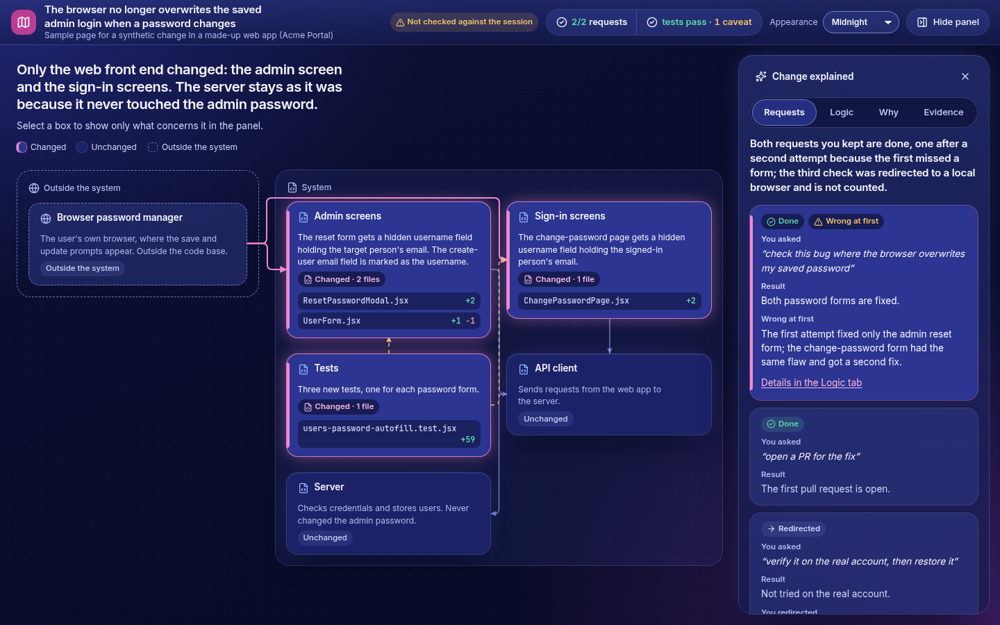
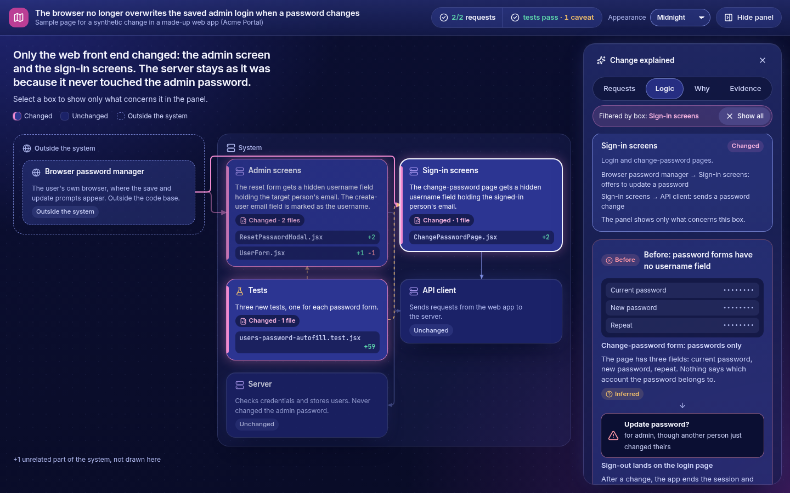
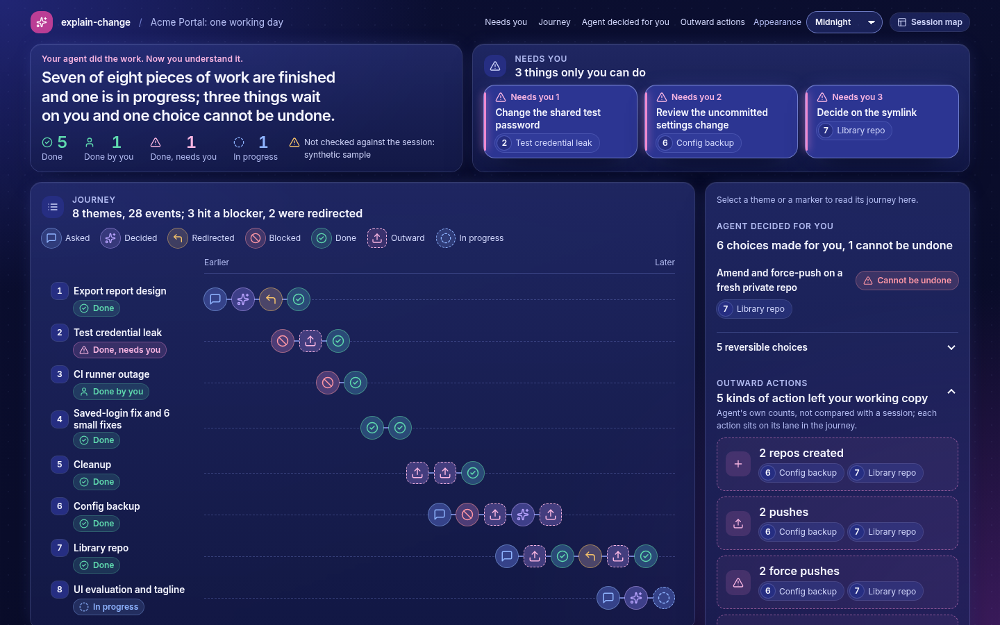
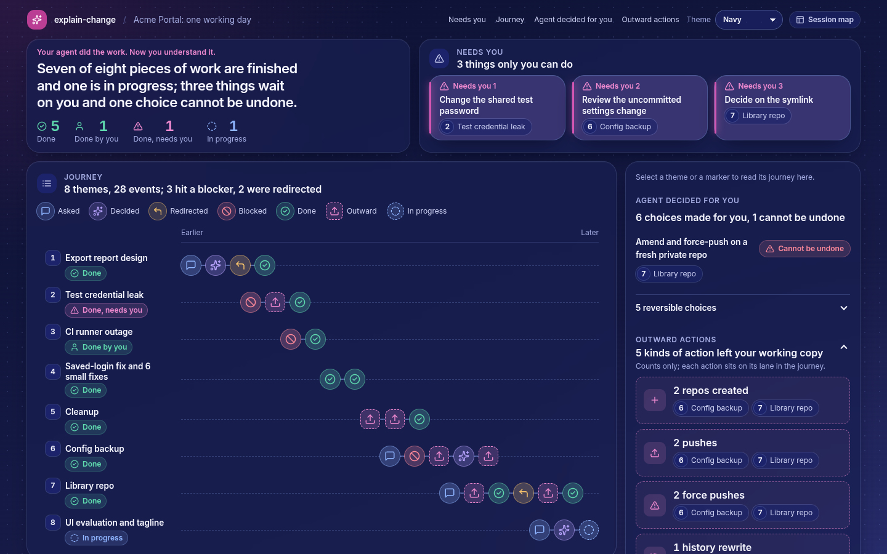
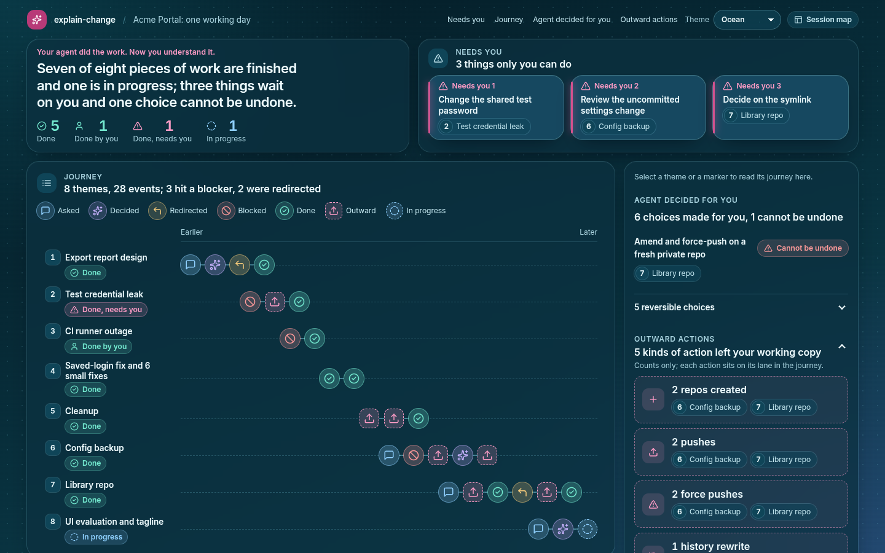
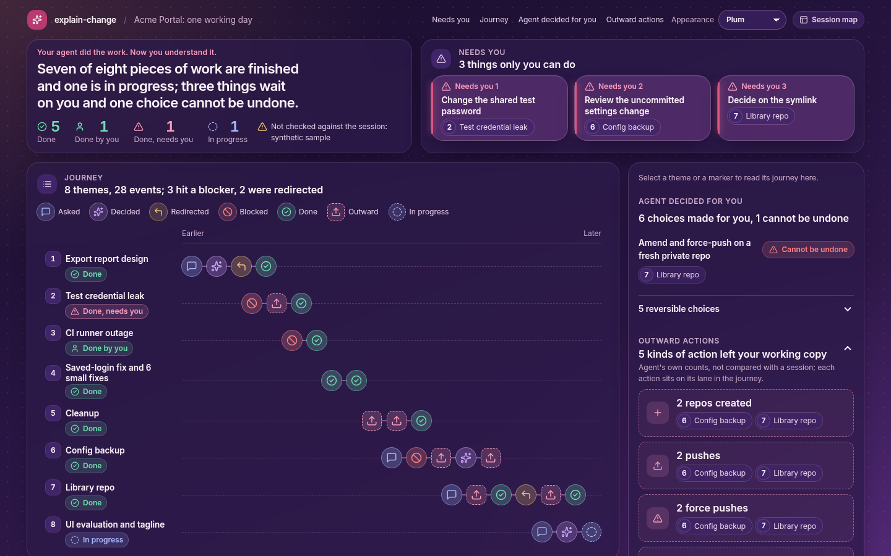
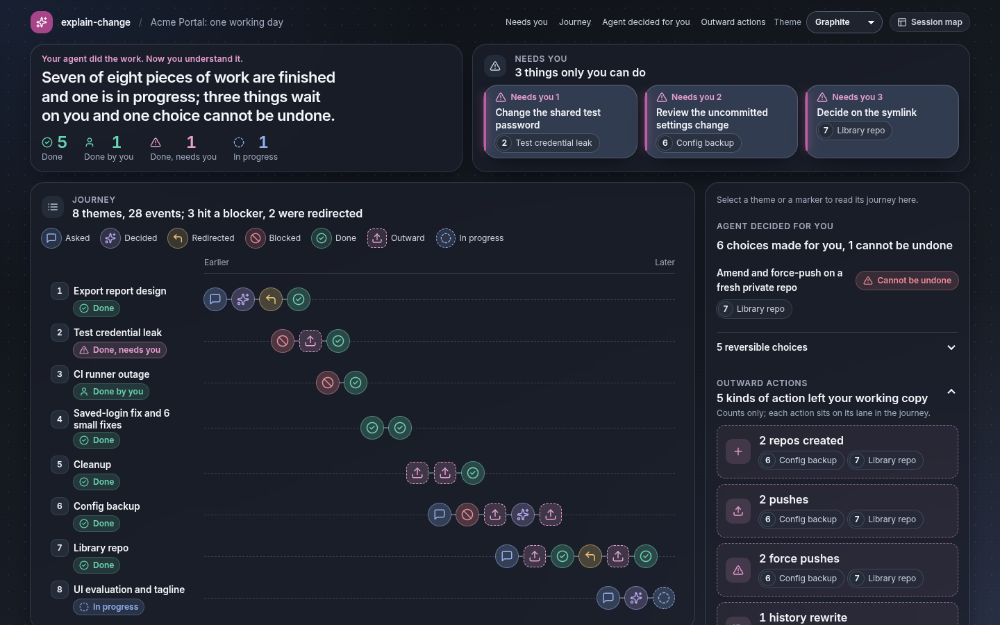
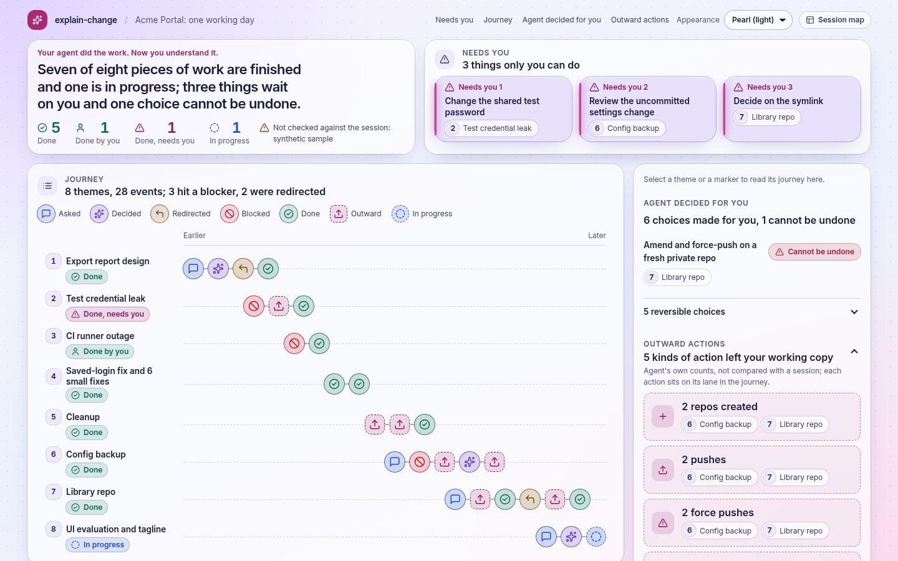

<div align="center">

# explain-change

### Your agent did the work. Now you understand it.

**An [Agent Skill](https://agentskills.io) that turns an agent's code change into one offline page you can actually understand. Installs in Claude Code, Codex, Gemini CLI, Copilot, Cursor, OpenCode, Kiro and more.**

[](https://github.com/epistex-dev/explain-change/actions/workflows/test.yml)




<sub>Sample page rendered from the bundled fixture <code>reference/examples/password-autofill.v2.json</code>. The change is synthetic.</sub>

</div>

## Why it exists

Agents now write code faster than their owners read it. A summary like "fixed the bug, tests pass" asks you to trust the change, and over time you ship code nobody on the team understands.

`explain-change` replaces that trust with a page. After an agent edit, the skill collects the diff and the session transcript, and the agent writes a structured `explain.json`. Scripts then check that file against the real repo and session, and render it as one self-contained HTML page. The page uses plain words and shows no code, diff or file:line: it is for the owner who did not write the change.

## What the page shows

Five blocks, in this order. Each opens with its one-sentence conclusion, and each fact appears in full in one block only; the others link to it.

| Block | Question it answers |
| --- | --- |
| **Request ↔ result** | What did you ask for, and what came of each request? |
| **Where it changed** | Which parts of the system changed and which stayed as they were? (the system map) |
| **How the new logic runs** | How did the logic run before, and how does it run now? (before and after pictures) |
| **Why** | Why this way, and which options were rejected? |
| **Evidence checked** | What was proven, how, and what was not checked? |

The map is the centre of the page. Click a box to filter the other four blocks to that part of the system.



## How claims are grounded

A claim without a source is labelled `inferred` on the page. Everything else is checked before the page is written:

- **Quotes are checked against the session transcript.** A request quote must occur in a message you typed; a rationale quote must occur in the session. A quote that is not there fails validation.
- **Tool-call evidence.** A "ran X" claim cites the command and an excerpt of its output, and both must occur in the same tool call. A worker's word with no tool call is labelled a worker's report and counted.
- **Cited code and counts.** Referenced lines are read at the right commit, and the files and +/- counts on the map must equal `git`.
- **Redaction of sensitive values.** The skill learns the secrets typed in the session (values after labels such as `password:`, and `ghp_`, `sk-`, `glpat-`, `Bearer` tokens). It rejects any doc that contains one and masks it in the digest and the page.

Details: [`references/explain-schema.md`](skills/explain-change/references/explain-schema.md).

### Transcript readers

The skill reads the session of seven harnesses (readers in `skills/explain-change/scripts/lib/adapters/`). Each reader turns its harness's records into one model (user messages, tool calls with their exit codes, outputs), and `collect.py`, `validate.py` and `render.py` ground a change doc or a session doc in any of them. Pass `--transcript <file>`; the format is detected, and `--format` names it. A transcript is read only under the harness's own folder after resolving symlinks, so a file the agent wrote itself cannot ground a claim. That folder is fixed per harness under your home directory (`$HOME`); for Claude Code `EXPLAIN_PROJECTS_DIR` also moves it. No command-line flag, `--format` included, moves it.

| Harness | Transcript folder | `--format` |
|---|---|---|
| Claude Code | `~/.claude/projects` | `claude` |
| GitHub Copilot CLI | `~/.copilot/session-state` | `copilot` |
| Codex | `~/.codex/sessions` | `codex` |
| OpenCode | `~/.local/share/opencode` (`opencode.db`; a session is named `<database path>#<session id>`) | `opencode` |
| Gemini CLI | `~/.gemini/tmp` | `gemini` |
| Cursor CLI | `~/.cursor/projects` | `cursor-cli` |
| Cursor IDE | `~/.config/Cursor/User/globalStorage` on Linux (the same folder of Cursor's user data on macOS and Windows) | `cursor-ide` |

A shell call whose output or exit code the harness did not record (every Cursor CLI and Cursor IDE call, an OpenCode call still running) has an unknown result: it can back a quote or a `mixed` run, never a `passed` run or a `done`. The readers are ported from open-source projects: see [THIRD_PARTY_NOTICES.md](THIRD_PARTY_NOTICES.md).

## Install

The skill is a folder with a `SKILL.md`, the [Agent Skills](https://agentskills.io/specification) format, so one install script puts it where each harness looks.

```bash
git clone https://github.com/epistex-dev/explain-change.git
cd explain-change
./install.sh                          # ~/.agents/skills + Claude Code, Kiro, Windsurf, Cline, Roo
./install.sh --harness codex,gemini   # only the folders these harnesses read
```

| Harness | Skills folder | Command |
| --- | --- | --- |
| Claude Code | `~/.claude/skills` | `./install.sh --harness claude`, or the [plugin](#claude-code-plugin) |
| Codex | `~/.agents/skills` | `./install.sh --harness codex` |
| Gemini CLI | `~/.agents/skills` | `./install.sh --harness gemini`, or `gemini extensions install https://github.com/epistex-dev/explain-change` |
| GitHub Copilot | `~/.agents/skills` | `./install.sh --harness copilot` |
| Cursor | `~/.agents/skills` | `./install.sh --harness cursor` |
| OpenCode | `~/.agents/skills` | `./install.sh --harness opencode` |
| Goose, Amp | `~/.agents/skills` | `./install.sh --harness goose` (or `amp`) |
| Kiro | `~/.kiro/skills` | `./install.sh --harness kiro` |
| Windsurf | `~/.codeium/windsurf/skills` | `./install.sh --harness windsurf` |
| Cline | `~/.cline/skills` | `./install.sh --harness cline` |
| Roo Code | `~/.roo/skills` | `./install.sh --harness roo` |

Harnesses that share `~/.agents/skills` get one link between them. `install.sh` links to the checkout, so `git pull` updates every harness; every path it touches is printed.

| Flag | Effect |
| --- | --- |
| `--copy` | copy the folder instead of linking it |
| `--project` | install under the current directory (`.agents/skills`, `.claude/skills`, `.kiro/skills`); use it with `--copy` to commit the skill |
| `--uninstall` | remove what the script installed, nothing else |
| `--dry-run` | print the paths and change nothing |
| `--force` | replace an existing folder the script did not create (it refuses without this) |

### Claude Code plugin

```text
/plugin marketplace add epistex-dev/explain-change
/plugin install explain-change@explain-change
```

The skill is then available as `explain-change` (namespaced `/explain-change:explain-change`).

### Manually

```bash
mkdir -p ~/.agents/skills
ln -s "$PWD/skills/explain-change" ~/.agents/skills/explain-change   # or: cp -r
```

### With the `skills` CLI

```bash
npx skills add epistex-dev/explain-change   # public release
```

The [`skills` CLI](https://github.com/vercel-labs/skills) installs a repo's skills into the agent you pick (`-a <agent>`).

### Requirements

Python 3 with the standard library only (no packages to install) and `git`. Tests of the edge router also use `node` when it is on `PATH`. The cold-read gate (step 6) uses a fresh subagent when the harness has one; otherwise set `EXPLAIN_COLDREAD_CMD` to a command that reads a prompt on stdin and prints its answer, for example `claude -p --tools "" --no-session-persistence`.

## Usage

Ask your agent after any agent edit: "explain this change", "giải thích thay đổi", or review a diff, commit or PR. The skill's seven steps then run:

1. **Collect**: `collect.py --v2 [<base>..<head> | <commit>] [--path <dir>]...` lists the changed files per module and the matching session transcripts.
2. **Read the session**: the agent finds the transcript that matches the task and the user's own words.
3. **Write**: the agent writes `explain.json`.
4. **Validate**: `validate.py explain.json --transcript <file>` checks every claim and prints `ok`.
5. **Render**: `render.py explain.json --transcript <file> --text` writes `index.html` (one file, under 512 KB, fonts inlined) next to the doc.
6. **Cold-read gate**: a fresh reader (a subagent, or `EXPLAIN_COLDREAD_CMD`) answers five questions from the page text alone.
7. **Show**: you get the path of `index.html`, opened in a preview.

The page language is `vi` by default and `en` through the doc's `lang` field.

To render the bundled sample without a repo or session:

```bash
python3 skills/explain-change/scripts/render.py \
  skills/explain-change/reference/examples/password-autofill.v2.json \
  --no-validate --out /tmp/sample.html
```

`--no-validate` skips the git and transcript checks, and the page says so.

### Whole sessions

After a long session, one task or many, ask for "explain this session". The agent runs `collect.py --session --transcript <file>`, writes an `explain-session/1` doc, checks it with `validate.py <doc> --transcript <file>` and renders it with `render.py <doc> --transcript <file>`. The page opens with a band: what is done, and what waits on you. Below it, one lane per theme shows the events in order, next to a side panel that lists what the agent decided for you (each marked reversible or not) and what left the working copy (pushes, force pushes, real deletes, pull requests). Select a marker to read that theme's journey in the same panel, and open the theme's change page when it has one. It shows no code, diff or file:line.



#### Colour themes

The session page comes in five colour themes: navy (the default), ocean, plum, graphite and pearl (light). The reader picks one with the "Appearance" control in the header and the page remembers it; `render.py --theme <id>` sets the theme the page opens in. Every theme keeps the text at 4.5:1 or better and the marker rings at 3:1 or better.

| navy | ocean | plum |
| --- | --- | --- |
|  |  |  |

| graphite | pearl |
| --- | --- |
|  |  |

To render the bundled sample:

```bash
python3 skills/explain-change/scripts/render.py \
  skills/explain-change/reference/examples/portal-day.session.json \
  --no-validate --theme ocean --out /tmp/session/index.html
```

The schema is in [`references/session-schema.md`](skills/explain-change/references/session-schema.md).

Reading order for the skill itself: [`SKILL.md`](skills/explain-change/SKILL.md) (steps), [`references/explain-schema.md`](skills/explain-change/references/explain-schema.md) (doc fields and rules), [`DESIGN.md`](skills/explain-change/DESIGN.md) (page design and decisions).

## Development

```text
.claude-plugin/        Claude Code plugin.json, marketplace.json
plugin.json            portable plugin manifest (Agent Plugins, read by Codex)
gemini-extension.json  Gemini CLI extension manifest
install.sh             installer for every harness
skills/explain-change/
  SKILL.md             the skill
  scripts/             collect.py, validate.py, render.py, lib/
  assets/              page CSS and JS, fonts, icons
  references/          the explain.json schema
  reference/           UI tokens and the bundled sample doc
  tests/               unit tests and the red check
docs/images/           screenshots used in this README
```

Run the tests:

```bash
python3 -m unittest discover -s skills/explain-change/tests
```

The red check removes each guard in a throwaway copy of the skill and requires its test to go red:

```bash
python3 skills/explain-change/tests/red_check.py
```

Validate the plugin manifests with `claude plugin validate .` and the skill with `skills-ref validate skills/explain-change` ([agentskills](https://github.com/agentskills/agentskills/tree/main/skills-ref)). CI runs the unit tests on every push and pull request (one job, Python 3.12).

## License

[MIT](LICENSE). Third-party fonts, icons and Mermaid keep their own licences: see [THIRD_PARTY_NOTICES.md](THIRD_PARTY_NOTICES.md).
