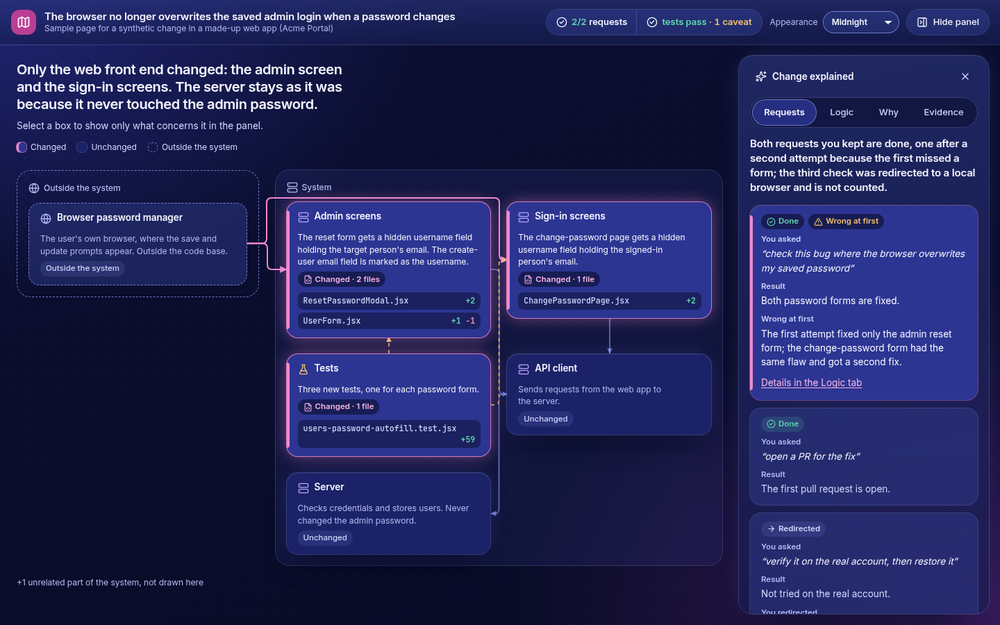
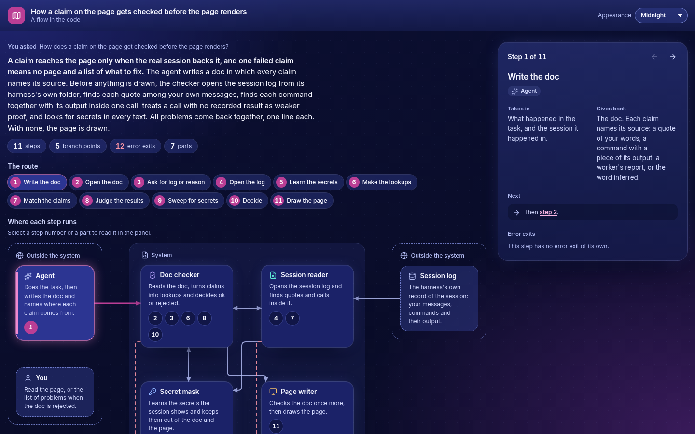

<div align="center">

# explain-change

### Your agent did the work. Now you understand it.

<a href="docs/media/intro.mp4"></a>

[](https://github.com/epistex-dev/explain-change/actions/workflows/test.yml)


</div>

An [Agent Skill](https://agentskills.io) that turns what your coding agent did into one fact-checked, offline HTML explainer page. It works in three modes: explain a change (diff plus session transcript), explain a whole agent session, or explain how an existing logic flow in your repo works. Every claim is grounded in the transcript or the code, secrets are masked, and it installs in Claude Code, Codex, Gemini CLI, GitHub Copilot CLI, Cursor, OpenCode, Kiro and more.

## What it does

| Change | Session | Flow |
| --- | --- | --- |
| What the agent changed and why, on a map of the system. | What a whole session did, decided for you and sent outward. | How an existing piece of code runs, step by step. |
|  |  |  |

More on each mode and the six colour themes: [docs/modes.md](docs/modes.md).

## Install

```bash
git clone https://github.com/epistex-dev/explain-change.git
cd explain-change
./install.sh
```

One script links the skill for Claude Code, Codex, Gemini CLI, Copilot, Cursor, OpenCode, Goose, Amp, Kiro, Windsurf, Cline and Roo (`--harness <name>` picks some). Flags, the Claude Code plugin and manual install: [docs/install.md](docs/install.md).

## Quick start

After any agent edit, ask your agent: "explain this change". For a whole session say "summarize this session", and for existing code "how does X work". It collects the evidence, writes and checks the doc, and gives you the path of the page. To see the bundled change and session samples, each checked against its synthetic transcript, run the helper below. It builds a throwaway git repo and a throwaway `HOME` in a temporary folder that it removes afterwards, and writes only `change/` and `session/` under the output folder. It refuses, with one line, to replace a `change/` or `session/` it did not write on an earlier run:

```bash
python3 tests/sample_env.py /tmp/samples
```

The pages are `/tmp/samples/change/index.html` and `/tmp/samples/session/index.html`.

The steps the agent follows are in [SKILL.md](skills/explain-change/SKILL.md).

## Supported harnesses

The skill grounds claims in the session transcript of these harnesses. Pass `--transcript <file>`; the format is detected, and `--format` names it. Every other harness works without a transcript: see [how it works](docs/how-it-works.md#when-no-transcript-is-readable).

| Harness | Transcript folder | `--format` |
|---|---|---|
| Claude Code | `~/.claude/projects` | `claude` |
| GitHub Copilot CLI | `~/.copilot/session-state` | `copilot` |
| Codex | `~/.codex/sessions` | `codex` |
| OpenCode | `~/.local/share/opencode` (`opencode.db`; a session is named `<database path>#<session id>`) | `opencode` |
| Gemini CLI | `~/.gemini/tmp` | `gemini` |
| Cursor CLI | `~/.cursor/projects` | `cursor-cli` |
| Cursor IDE | `~/.config/Cursor/User/globalStorage` on Linux (the same folder of Cursor's user data on macOS and Windows) | `cursor-ide` |

## Docs

- [Install](docs/install.md): every harness, flags, plugin
- [How it works](docs/how-it-works.md): grounding, transcript readers, runs without a transcript
- [Modes and themes](docs/modes.md): change, session, flow and the theme gallery
- [Design notes](docs/design.md)
- [Contributing](CONTRIBUTING.md) and [Security](SECURITY.md)

## License

[MIT](LICENSE). Third-party fonts and icons keep their own licences: see [THIRD_PARTY_NOTICES.md](THIRD_PARTY_NOTICES.md).
