# Modes and themes

The skill has three modes. Each renders one offline HTML page in the same six colour themes.

| Mode | Ask | Input | Doc kind |
| --- | --- | --- | --- |
| Change | "explain this change", "giải thích thay đổi" | a diff and the session transcript | `explain-change/2` |
| Session | "summarize this session" | a session transcript | `explain-session/1` |
| Flow | "how does X work", "luồng này chạy thế nào" | the code at one commit | `explain-flow/1` |

The agent follows [SKILL.md](../skills/explain-change/SKILL.md). Each command below renders a bundled sample. The change and session samples are checked against synthetic transcripts (`references/examples/*.transcript.jsonl`); the readers take a transcript only inside the harness's own folder, so the helper `tests/sample_env.py` builds a throwaway git repo and a throwaway `HOME` that holds the transcripts under `~/.claude/projects/`. The flow sample needs neither.

## Change

After any agent edit, ask for "explain this change", or review a diff, commit or PR. The page has five blocks, in this order. Each opens with its one-sentence conclusion, and each fact appears in full in one block only; the others link to it.

| Block | Question it answers |
| --- | --- |
| **Request ↔ result** | What did you ask for, and what came of each request? |
| **Where it changed** | Which parts of the system changed and which stayed as they were? (the system map) |
| **How the new logic runs** | How did the logic run before, and how does it run now? (before and after pictures) |
| **Why** | Why this way, and which options were rejected? |
| **Evidence checked** | What was proven, how, and what was not checked? |

The map is the centre of the page. Click a box to filter the other four blocks to that part of the system.

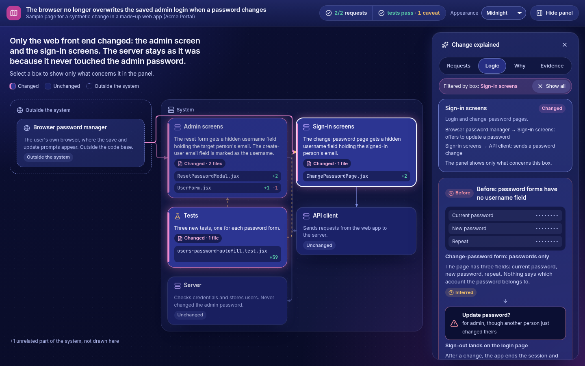

```bash
python3 tests/sample_env.py /tmp/samples   # change page: /tmp/samples/change/index.html
```

The helper validates and renders the sample against its synthetic repo and transcript. On your own change, run `validate.py` and `render.py` as in [SKILL.md](../skills/explain-change/SKILL.md); `--no-validate` skips the git and transcript checks, and the page says so. Fields and rules: [`explain-schema.md`](../skills/explain-change/references/explain-schema.md).

## Session

After a long session, one task or many, ask for "explain this session". The page opens with a band: what is done, and what waits on you. Below it, one lane per theme shows the events in order, next to a side panel that lists what the agent decided for you (each marked reversible or not) and what left the working copy (pushes, force pushes, real deletes, pull requests). Select a marker to read that theme's journey in the same panel, and open the theme's change page when it has one. It shows no code, diff or file:line.

```bash
python3 tests/sample_env.py /tmp/samples   # session page: /tmp/samples/session/index.html
```

Schema and workflow: [`session-schema.md`](../skills/explain-change/references/session-schema.md).

## Flow

To understand how existing code runs, with no change and no session to read, ask "how does X work". The agent reads the code and writes a doc with the parts of the system, the steps in order, what each takes in and gives back, the branches and the error exits, each tied to lines of one commit. The page shows the question and summary, the numbered route, a map of the parts and a panel for the selected step. It shows no code, diff or file:line, and its footer names the commit it was checked against. `#step-N` in the URL opens step N, and without JS every step is on the page.

```bash
python3 skills/explain-change/scripts/render.py \
  skills/explain-change/references/examples/claim-check.flow.json \
  --no-validate --out /tmp/flow/index.html
```

Schema and workflow: [`explain-flow-schema.md`](../skills/explain-change/references/explain-flow-schema.md).

## Colour themes

All three pages come in the same six themes: midnight (the default, the colours of the intro video), navy, ocean, plum, graphite and pearl (light). The reader picks one with the "Appearance" control in the header and the pages remember it, so a pick made on one opens the others; `render.py --theme <id>` sets the theme a page opens in. Every theme keeps the text at 4.5:1 or better and the marker rings at 3:1 or better. Design decisions: [design.md](design.md).

The change page:

| midnight | navy | ocean |
| --- | --- | --- |
| 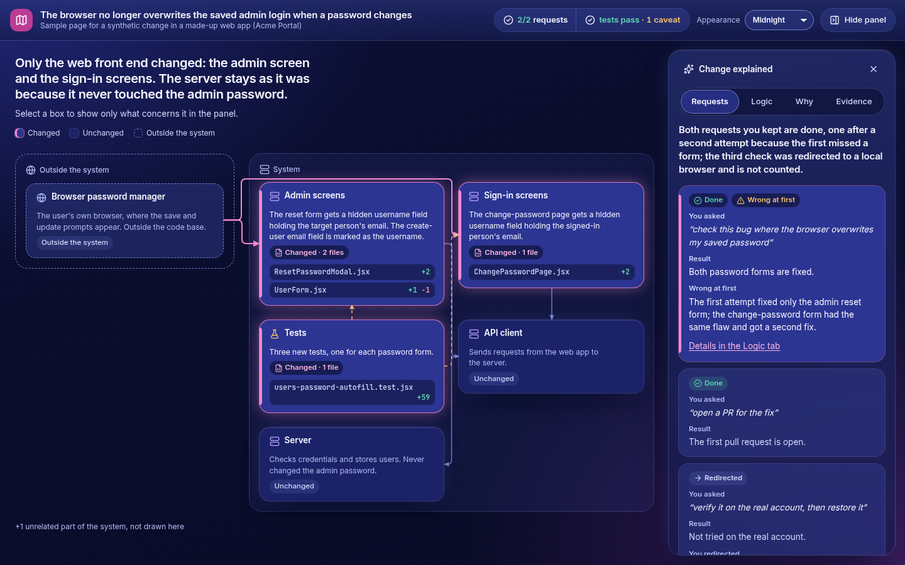 | 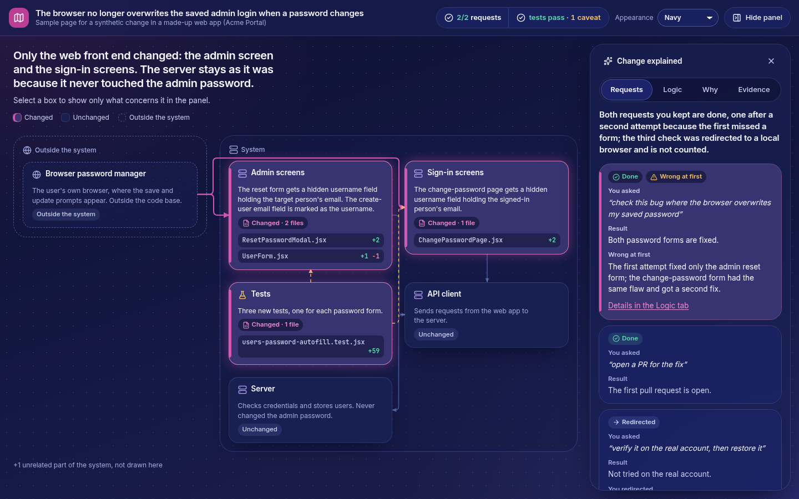 | 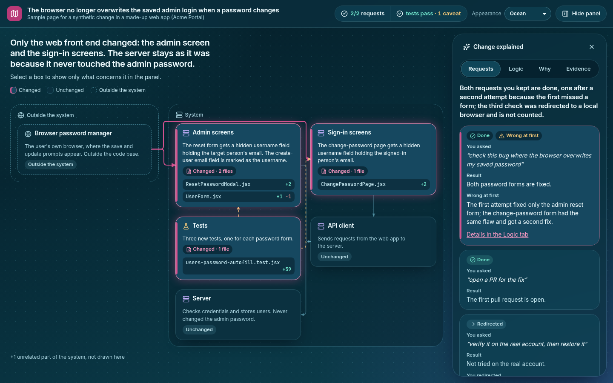 |

| plum | graphite | pearl |
| --- | --- | --- |
| 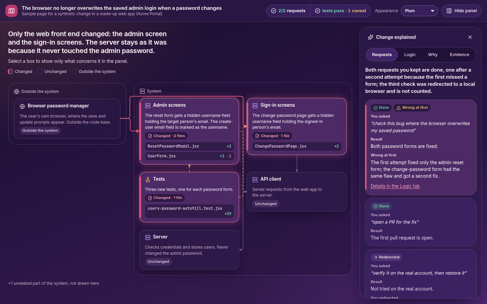 | 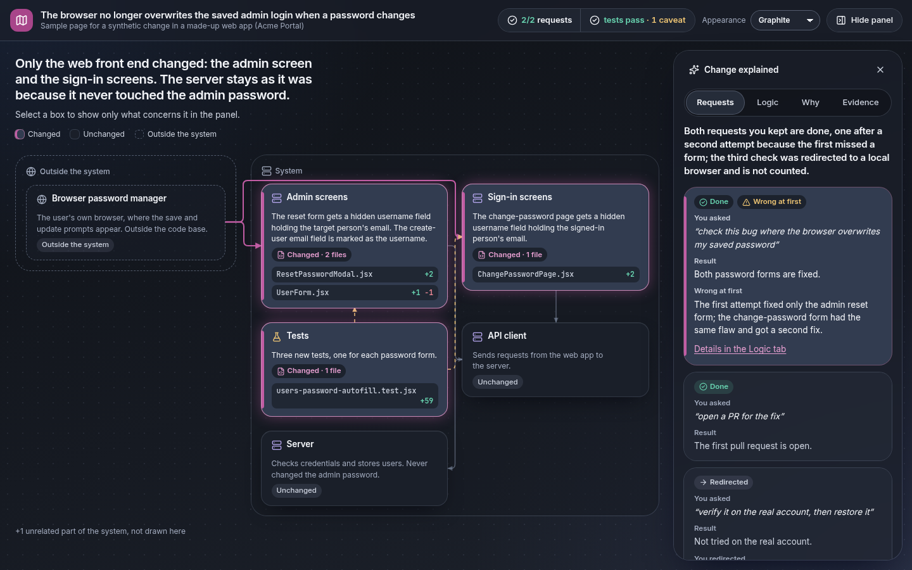 | 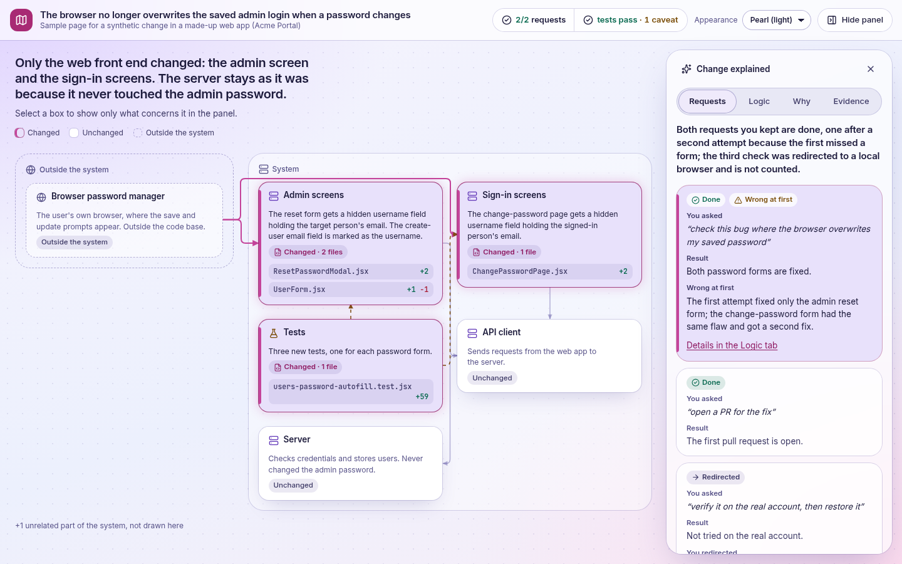 |

The session page:

| midnight | navy | ocean |
| --- | --- | --- |
| 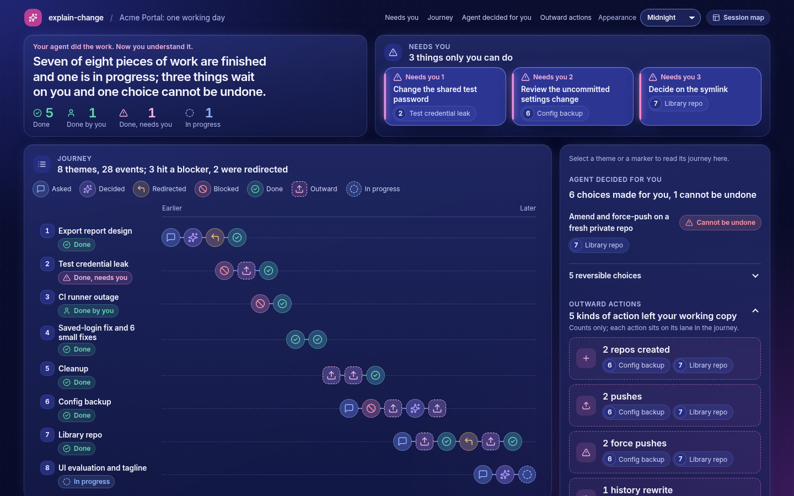 | 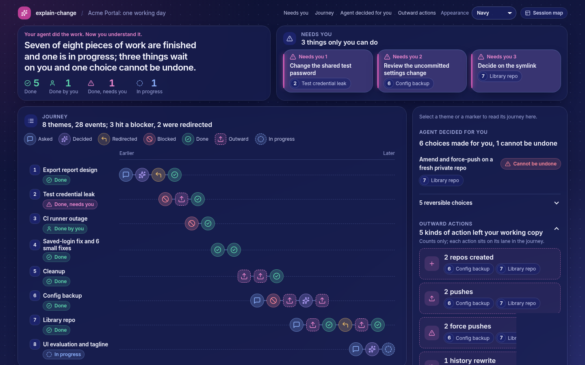 | 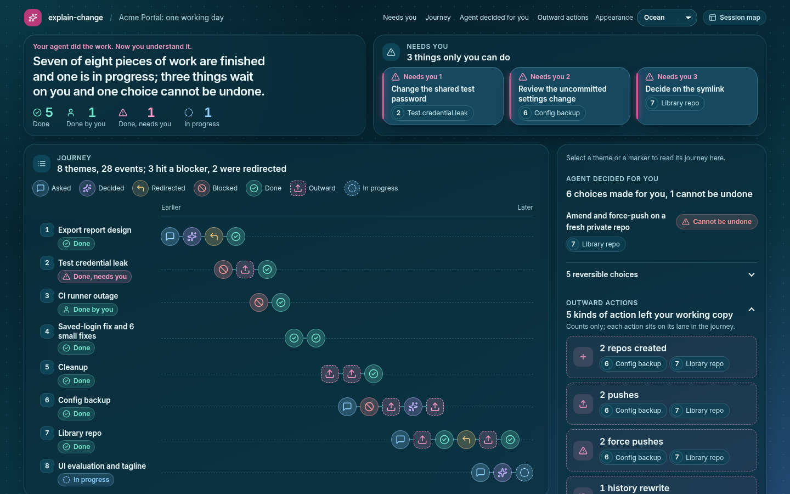 |

| plum | graphite | pearl |
| --- | --- | --- |
| 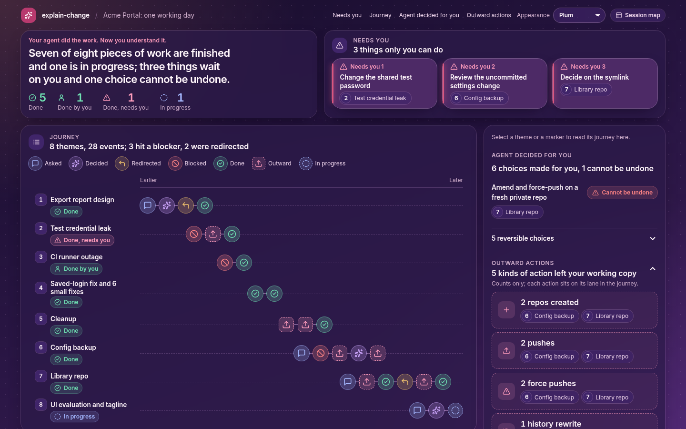 | 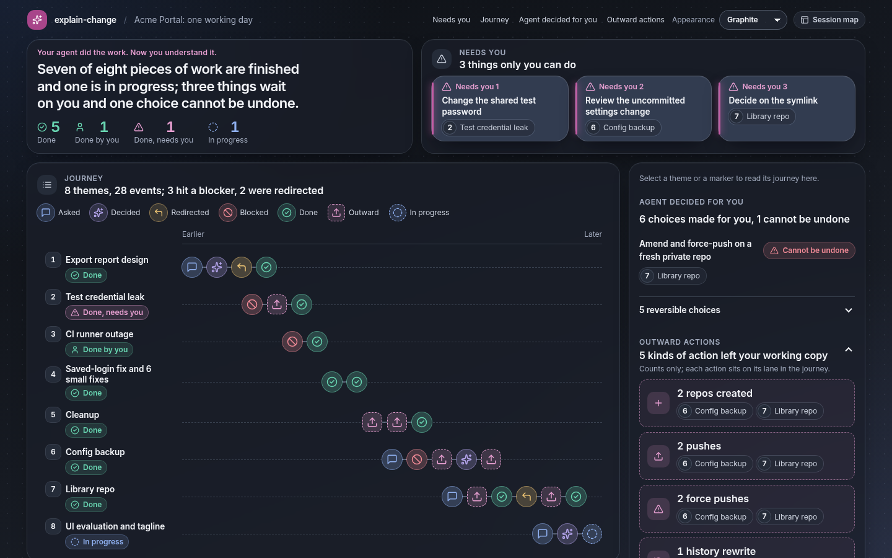 | 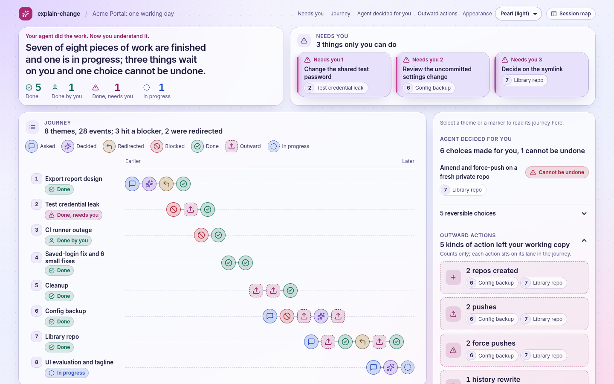 |
